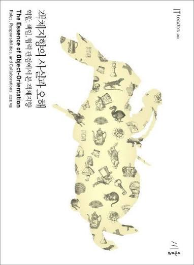

# 객체지향의 사실과 오해

객체지향의 사실과 오해를 읽으며 챕터별로 정리한 내용.

객체지향적인 로직을 구현하는 방법뿐만 아니라, **서비스 내의 객체들이 알맞은 책임과 역할을 지녀야 하는 이유**를 이해한다.

| 책 후기                                     | 작성자 |
|------------------------------------------| --- |
| [객체지향을 조금 더 알게 해준 고마운 책](https://geniusjun4663.tistory.com/60) | 창준 |
